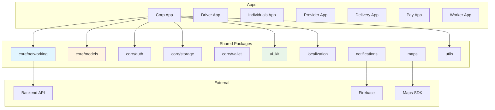
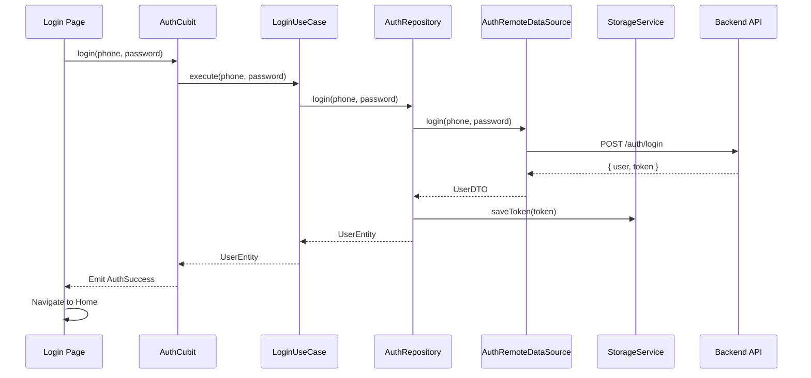

# Fullup — Architecture

## Monorepo Structure

```
fullup/
├── apps/                          # Individual Flutter apps
│   ├── corp/                      # Corporate app
│   ├── delivery/                  # Delivery app
│   ├── driver/                    # Driver app
│   ├── individuals/               # Individual users app
│   ├── pay/                       # Payment app
│   ├── provider/                  # Service provider app
│   └── worker/                    # Worker app
│
├── packages/                      # Shared packages (all apps can use)
│   ├── core/
│   │   ├── auth/                  # Auth logic, token management
│   │   ├── models/                # Shared entities, enums, API response models
│   │   ├── networking/            # Dio client, interceptors
│   │   ├── storage/               # SharedPreferences + SecureStorage wrapper
│   │   └── wallet/                # Wallet/payment shared logic
│   ├── localization/              # easy_localization, translation assets
│   ├── maps/                      # Map integration (Google Maps, etc.)
│   ├── notifications/             # Push notifications (FCM)
│   ├── ui_kit/                    # Shared widgets, theme, extensions
│   └── utils/                     # Formatters, helpers, validators
│
├── pubspec.yaml                   # Root workspace config
└── analysis_options.yaml          # Shared lint rules
```

---

## Clean Architecture Layers

```
Presentation → Domain → Data
     ↓            ↓         ↓
  UI/BLoC    UseCases   DataSources/DTOs
```

### Layer Rules

| Rule | Description |
|------|-------------|
| **Presentation → Domain only** | UI/BLoC never imports from Data layer |
| **Domain → Nothing** | Pure Dart, no Flutter imports |
| **Data → Implements Domain** | DTOs, API calls, local storage |
| **DTOs ≠ Entities** | Convert API DTOs to domain entities before reaching UI |

### Data Flow

```
User Action → Page → BLoC/Cubit → UseCase → Repository → DataSource → API
                                                                        ↓
UI ← Page ← BLoC/Cubit (State) ← UseCase ← Repository ← DTO ← Response
```

---

## Feature Module Structure

Each feature inside an app follows this structure:

```
lib/features/[feature_name]/
├── data/
│   ├── datasources/
│   │   ├── [feature]_remote_datasource.dart   # API calls (Dio)
│   │   └── [feature]_local_datasource.dart    # Local storage (optional)
│   ├── dtos/
│   │   └── [feature]_dto.dart                 # JSON serializable models
│   └── repositories/
│       └── [feature]_repository_impl.dart     # Implements domain interface
│
├── domain/
│   ├── repositories/
│   │   └── [feature]_repository.dart          # Abstract interface
│   └── usecases/
│       └── [usecase_name].dart                # Single-purpose use cases
│
├── logic/
│   ├── [feature]_cubit.dart                   # State management (Cubit)
│   └── [feature]_state.dart                   # State definitions
│
└── presentation/
    ├── pages/
    │   └── [feature]_page.dart                # Full screen widgets
    └── widgets/
        └── [feature]_widget.dart              # Feature-specific widgets
```

### When to Use BLoC vs Cubit

| Use **BLoC** (with Events) | Use **Cubit** (with methods) |
|----------------------------|------------------------------|
| Complex flows with multiple events | Simple state changes, CRUD |
| Event transformations needed | Direct method calls suffice |
| Stream-based (search debounce) | Toggle, load, submit |
| Auth flow, pagination | Profile, favorites, settings |

---

## App Structure (per app)

```
apps/[app_name]/
├── assets/
│   ├── fonts/
│   ├── images/
│   └── translations/           # App-specific translations
├── lib/
│   ├── core/
│   │   ├── constants/          # App constants, API URLs
│   │   ├── di/                 # getIt setup (manual registration)
│   │   └── router/             # go_router configuration
│   └── features/               # Feature modules
│       ├── auth/
│       ├── home/
│       └── ...
└── test/
```

---

## Shared Packages Architecture

### `packages/core/networking`

```
networking/
└── lib/src/
    ├── client/                 # Dio wrapper, ApiClient
    └── interceptors/           # Auth, logging, error, rate-limit interceptors
```

### `packages/core/models`

```
models/
└── lib/src/
    ├── entities/               # Shared domain entities (User, Order, etc.)
    └── enums/                  # Shared enums
```

### `packages/ui_kit`

```
ui_kit/
└── lib/src/
    ├── extensions/             # BuildContext, String, etc. extensions
    ├── theme/                  # AppTheme, AppColors, TextStyles
    └── widgets/                # Reusable widgets (buttons, inputs, cards)
```

---

## Dependency Injection

```
getIt — manual registration in apps/<app>/lib/core/di/injection_container.dart
```

| Registration | When to use |
|--------------|-------------|
| `registerLazySingleton` | Services, repositories, data sources |
| `registerFactory` | Cubits, use cases |
| `registerFactoryParam` | Cubits that need a runtime argument (e.g. an order id) |

Apps do not use injectable annotations or build_runner for DI. Only some core
packages (`core/networking`, `core/auth`, `core/storage`) carry injectable codegen.

Each app has its own DI container in `lib/core/di/`. Shared packages register their own dependencies.

---

## Navigation

```
go_router
```

- Each app has its own router in `lib/core/router/app_router.dart`
- Use named routes
- Pass data via route parameters or `extra`
- Use `ShellRoute` for bottom navigation
- Handle deep linking

---

## System Architecture Diagram



---

## Data Flow — Authentication (Example)



---

## STRICTLY FORBIDDEN

- NO Provider, Riverpod, or any state management except BLoC/Cubit
- NO creating dependencies inside widgets — resolve through getIt (registered in `injection_container.dart`)
- NO Navigator.push/pop — use go_router
- NO direct API calls in UI — use Repository pattern
- NO business logic in UI components — use UseCases
- NO direct DTOs in UI — map to domain entities
- NO mixing layers — keep Presentation, Domain, Data separate
- NO app-specific code in shared packages
- NO direct package imports between apps — share via packages only
